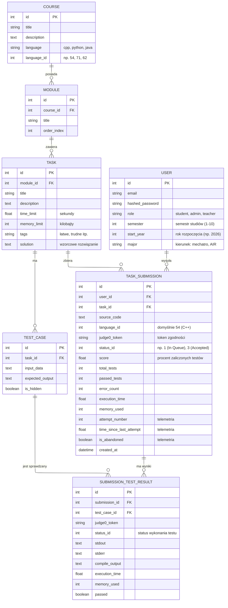

# MechaCode

## Diagram ERD



`TASK_SUBMISSION` reprezentuje jedno wysłanie rozwiązania przez użytkownika.
Judge0 wykonuje każdy przypadek testowy osobno, dlatego jeden submission może
mieć wiele rekordów `SUBMISSION_TEST_RESULT`. Każdy z nich przechowuje osobny
token Judge0 oraz wynik konkretnego testu.

Pole `solution` w tabeli `TASK` przechowuje oficjalne, wzorcowe rozwiązanie
zadania (kod źródłowy w języku danego kursu), które jest wyświetlane w zakładce
"Rozwiązania" na platformie.

## Migracje bazy danych

Wszystkie migracje schematu bazy danych znajdują się w katalogu `DB/migrations/`.
W przypadku aktualizacji schematu bazy na środowisku produkcyjnym, należy wykonać
odpowiedni skrypt SQL na kontenerze bazy danych `mechacode-db`, np.:

```bash
docker exec -i mechacode-db psql -U mechacode_user -d mechacode_db < DB/migrations/20261028_add_task_solution.sql
```

Dostępne migracje:
- `20261028_add_user_academic_fields.sql` – dodanie pól akademickich (`semester`, `start_year`, `major`) do tabeli `users`.
- `20261028_add_task_tags.sql` – dodanie kolumny `tags` (poziom trudności) do tabeli `tasks`.
- `20261028_add_course_language.sql` – dodanie kolumn `language` i `language_id` do tabeli `courses`.
- `20261028_add_task_solution.sql` – dodanie kolumny `solution` do tabeli `tasks`.

## Uprawnienia ról API

Platforma wspiera trzy role użytkowników:
- **`student`**: Przeglądanie katalogu kursów, zadań (z odfiltrowanymi ukrytymi testami), wysyłanie rozwiązań oraz przeglądanie wyłącznie własnych zgłoszeń i historii. Brak dostępu do endpointów modyfikujących strukturę kursów lub konta innych użytkowników.
- **`teacher`**: Wszystkie uprawnienia studenta oraz pełne zarządzanie kursami, modułami, zadaniami i przypadkami testowymi (`POST`, `PUT`, `DELETE` dla `/courses/`, `/modules/`, `/tasks/`, `/test-cases/`). Podgląd ukrytych testów oraz zgłoszeń dowolnego studenta.
- **`admin`**: Pełne uprawnienia w systemie, w tym zarządzanie użytkownikami (`GET`, `PUT`, `DELETE` na `/users/`) oraz zmiana ról.

## Wdrażanie frontendu na Azure

Na serwerze Azure, w katalogu projektu, uruchom:

```bash
chmod +x deploy_front.sh
./deploy_front.sh
```

Skrypt kopiuje pliki frontendu (`index.html`, `styles.css`, `app.js`, `marked.min.js`, `katex.min.js`, `katex.min.css`)
do `/var/www/mechacode-front`. Jeśli katalog docelowy ma inną lokalizację, można ją przekazać
przez zmienną:

```bash
WEB_ROOT=/www ./deploy_front.sh
```

Skrypt używa `sudo` do utworzenia katalogu i instalacji plików z prawami
`0644`.

## Pełne wdrożenie na Azure

Skrypt `deploy_all.sh` pobiera najnowszy kod, przebudowuje obraz API bez
cache, odtwarza wszystkie usługi Docker Compose oraz kopiuje frontend do
`/var/www/mechacode-front`:

```bash
cd ~/mechacode/Mecha2Code
chmod +x deploy_all.sh deploy_front.sh
./deploy_all.sh
```

Repozytorium Git powinno znajdować się w `~/mechacode/Mecha2Code` (albo
w katalogu `~/mechacode`). Jeśli projekt nie został jeszcze sklonowany:

```bash
cd ~/mechacode
git clone <URL_REPOZYTORIUM> Mecha2Code
cd Mecha2Code
./deploy_all.sh
```

Skrypt używa `docker compose up -d --force-recreate`, ale nie wykonuje
`docker compose down`, więc nie usuwa ani nie odłącza volume'ów baz danych.