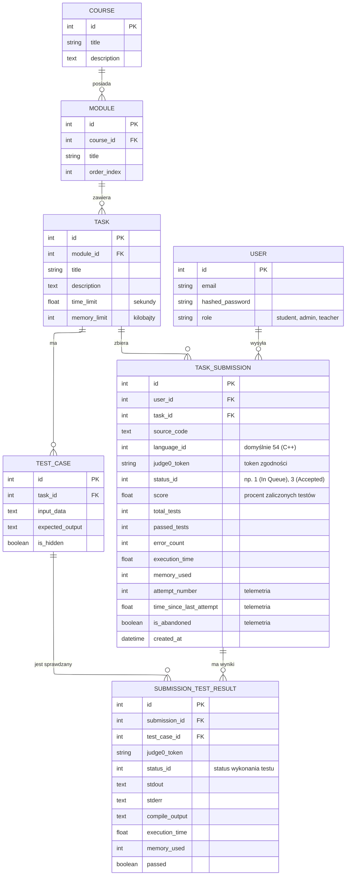

# MechaCode

## Diagram ERD



`TASK_SUBMISSION` reprezentuje jedno wysłanie rozwiązania przez użytkownika.
Judge0 wykonuje każdy przypadek testowy osobno, dlatego jeden submission może
mieć wiele rekordów `SUBMISSION_TEST_RESULT`. Każdy z nich przechowuje osobny
token Judge0 oraz wynik konkretnego testu.

## Wdrażanie frontendu na Azure

Na serwerze Azure, w katalogu projektu, uruchom:

```bash
chmod +x deploy_front.sh
./deploy_front.sh
```

Skrypt kopiuje `front/index.html`, `front/styles.css` oraz `front/app.js`
do `/var/www/mechacode-front`. Jeśli katalog docelowy ma inną lokalizację, można ją przekazać
przez zmienną:

```bash
WEB_ROOT=/www ./deploy_front.sh
```

Skrypt używa `sudo` do utworzenia katalogu i instalacji plików z prawami
`0644`.

## Pełne wdrożenie na Azure

Skrypt `deploy_all.sh` pobiera najnowszy kod, przebudowuje obraz API bez
cache, odtwarza wszystkie usługi Docker Compose oraz kopiuje frontend do
`/var/www/mechacode-front`:

```bash
cd ~/mechacode/Mecha2Code
chmod +x deploy_all.sh deploy_front.sh
./deploy_all.sh
```

Repozytorium Git powinno znajdować się w `~/mechacode/Mecha2Code` (albo
w katalogu `~/mechacode`). Jeśli projekt nie został jeszcze sklonowany:

```bash
cd ~/mechacode
git clone <URL_REPOZYTORIUM> Mecha2Code
cd Mecha2Code
./deploy_all.sh
```

Skrypt używa `docker compose up -d --force-recreate`, ale nie wykonuje
`docker compose down`, więc nie usuwa ani nie odłącza volume'ów baz danych.